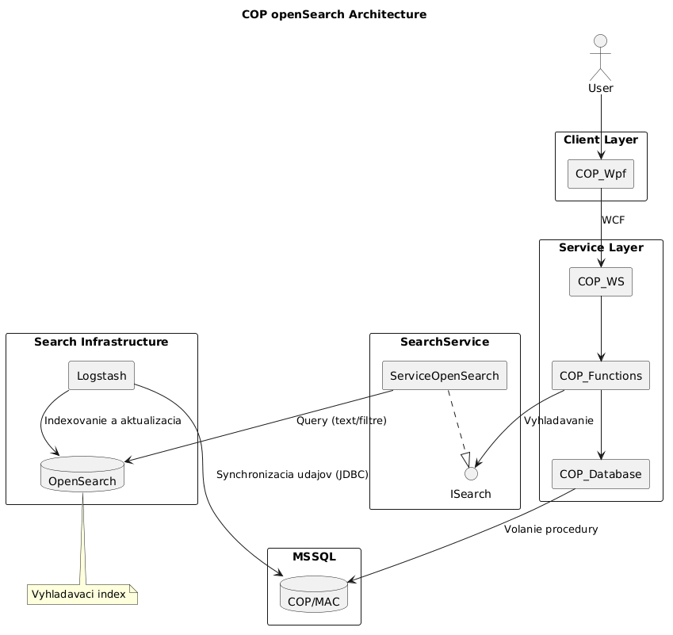
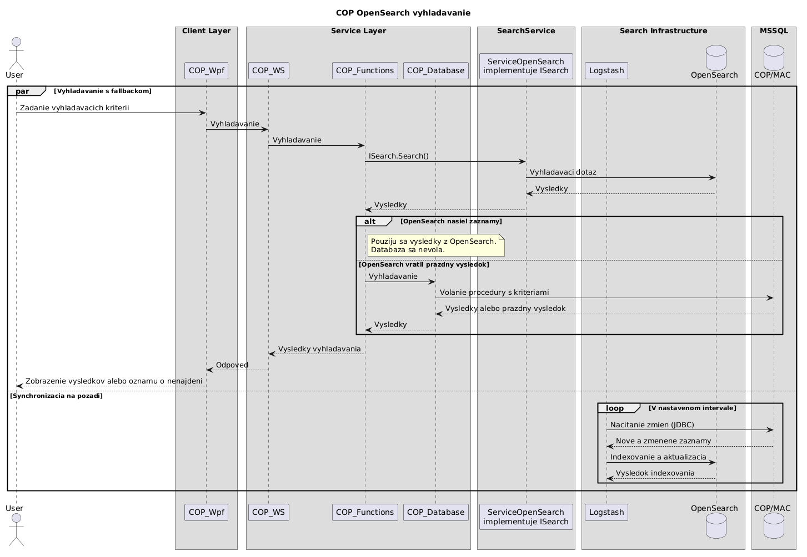

# Integrácia OpenSearch

OpenSearch slúži ako vyhľadávací index pre aplikáciu COP. Používateľ zadáva
kritériá v klientovi `COP_Wpf`, odkiaľ požiadavka pokračuje cez `COP_WS` do
vrstvy `COP_Functions`. Tá pri vyhľadávaní využíva rozhranie `ISearch`, ktoré
implementuje služba `ServiceOpenSearch`.

Vyhľadávanie je oddelené od konkrétnej implementácie: `COP_Functions` volá
metódu `ISearch.Search()` a `ServiceOpenSearch` zabezpečuje komunikáciu
s OpenSearch. Dotaz obsahuje text a filtre. Výsledok sa vracia cez tú istú
vrstvu až do klienta, ktorý ho zobrazí používateľovi.

Ak OpenSearch vráti aspoň jeden záznam, použijú sa tieto výsledky a databázová
procedúra sa nevolá. Ak je výsledok prázdny, `COP_Functions` odovzdá kritériá
komponentu `COP_Database`, ktorý vykoná databázové vyhľadávanie nad COP/MAC.
Nájdené záznamy alebo prázdny výsledok sa následne vrátia klientovi. Diagram
zachytáva fallback pri prázdnom výsledku; správanie pri nedostupnosti
OpenSearch ani pri chybe požiadavky v ňom nie je špecifikované.

Aktualizácia indexu prebieha nezávisle od požiadaviek používateľov. Logstash
v nastavenom intervale načíta cez JDBC z MSSQL nové a zmenené záznamy a odošle
ich do OpenSearch na indexovanie alebo aktualizáciu. Tým sa udržiava
vyhľadávací index synchronizovaný so zdrojovou databázou.

## Architektúra

Diagram zobrazuje komponenty aplikácie, vyhľadávaciu službu a tok údajov medzi
MSSQL, Logstashom a OpenSearch.

## Implementačný tok

Spracovanie požiadavky prechádza týmito krokmi:

1. `COP_Wpf` odošle kritériá cez WCF do `COP_WS`.
2. `COP_WS` ich postúpi do `COP_Functions`, ktoré zavolá `ISearch.Search()`.
3. `ServiceOpenSearch` zostaví a odošle dotaz s textom a filtrami do
   vyhľadávacieho indexu OpenSearch a vráti získané výsledky.
4. Pri neprázdnom výsledku sa pokračuje priamo odpoveďou do klienta. Pri
   prázdnom výsledku sa požiadavka postúpi cez `COP_Database` do MSSQL, kde sa
   vykoná procedúra s vyhľadávacími kritériami.
5. Výsledky zvolenej cesty sa vrátia cez `COP_WS` do `COP_Wpf` a zobrazia sa
   používateľovi.

Paralelne s týmto tokom Logstash pravidelne číta zmeny z databázy a zapisuje
ich do OpenSearch. Index tak slúži na vyhľadávanie, zatiaľ čo MSSQL zostáva
zdrojom údajov pre synchronizáciu a záložné vyhľadávanie.

